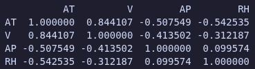
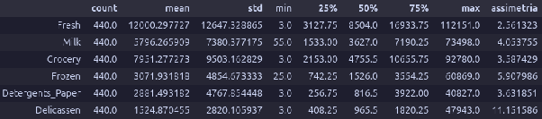
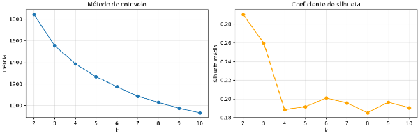
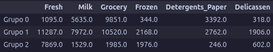
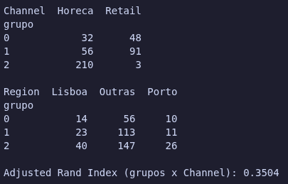
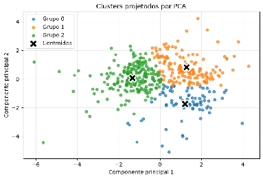

**Relatório – 1ª Lista de Projetos**

**Disciplina:** PAM0466 – Sistemas Inteligentes (2026.2)  
**Docente:** Pedro Thiago Valério de Souza  
**Discente**: Antonio Erick da Silveira Farias Oliveira

**Sumário**

**1\. Problema 1 – Regressão Linear (usina de ciclo combinado)**  
**2\. Problema 2 – Regressão Logística (doenças cardíacas)**  
**3\. Problema 3 – k-NN (qualidade de vinhos)**  
**4\. Problema 5 – k-Means (segmentação de clientes)**

Todos os códigos foram desenvolvidos em Python (pandas, NumPy, matplotlib, scikit-learn). Em todos os problemas foi usada a semente “random\_state=42”, para que os resultados sejam reproduzíveis.

**Problema 1 – Regressão Linear para Previsão de Produção de Energia**

**1\. Introdução**

Uma usina termelétrica de ciclo combinado (UTCC) combina uma turbina a gás (ciclo Brayton) com uma turbina a vapor (ciclo Rankine). A potência elétrica de saída (PE) é muito sensível às condições ambientais. O objetivo deste projeto é construir um modelo de regressão linear múltipla que preveja PE a partir de quatro sensores ambientais:

| Variável | Descrição | Unidade |
| :---- | :---- | :---- |
| AT | Temperatura ambiente | °C |
| V | Vácuo de escape | cm Hg |
| AP | Pressão atmosférica | mbar |
| RH | Umidade relativa | % |
| PE | Potência elétrica líquida horária (variável alvo) | MW |

O dataset utilizado é o UCI CCPP (Combined Cycle Power Plant), com 9.568 amostras coletadas ao longo de 6 anos.

## **2\. Pré-processamento dos dados**

1. **Leitura:** o arquivo `Folds5x2_pp.xlsx` tem 5 abas com os mesmos dados embaralhados. Foi lida apenas a primeira aba (`sheet_name=0`), evitando duplicar as amostras.  
2. **Conferência da estrutura:** o dataframe tem formato de 9.568 amostras e 5 colunas, todas numéricas.  
3. **Valores ausentes:** **0** em todas as colunas. Portanto, **não foi necessário tratar valores ausentes** (nem imputar, nem remover linhas).  
4. **Linhas duplicadas:** a contagem de duplicadas foi verificada com `df.duplicated().sum()` (resultado: 41). Como são medições de sensores que podem se repetir por coincidência, as linhas foram mantidas.  
5. **Divisão treino/teste:** 80% das amostras para treino e 20% para teste. Foi utilizada uma semente (`random_state=42`) para tornar o experimento reprodutível.  
6. **Padronização (Z-score):** as variáveis independentes foram padronizadas com `StandardScaler`, que transforma cada coluna para média 0 e desvio padrão 1\. O escalonador foi **ajustado (`fit`) somente nos dados de treino** e apenas **aplicado (`transform`) no teste**. Isso evita *vazamento de dados* (data leakage), pois o teste deve simular dados nunca vistos.

## **3\. Análise de correlação**

### **3.1 Correlação entre as variáveis independentes e PE**

| Variável | Correlação com PE |
| :---- | :---- |
| AT | −0,948 |
| V | −0,870 |
| AP | \+0,518 |
| RH | \+0,390 |

**Análise:**

* **AT (temperatura)** é a variável com maior influência: correlação de −0,95, muito forte e negativa. Quanto mais quente o ar, menos denso ele é, o que reduz a massa de ar que entra na turbina a gás e diminui a potência gerada.  
* **V (vácuo de escape)** é a segunda mais influente (−0,87), também forte e negativa. Está ligada à pressão na turbina a vapor: maior vácuo de escape corresponde a pior desempenho do ciclo Rankine.  
* **AP (pressão)** e **RH (umidade)** têm correlação positiva e moderada (0,52 e 0,39). Elas influenciam PE, mas bem menos que AT e V.

Portanto, **AT e V são as variáveis de maior influência** na produção de energia.

### **3.2 Correlação entre as variáveis independentes**

  
**Análise:** Existe uma relação forte entre **AT e V (0,84)**. Isso é um indício de **multicolinearidade moderada**: as duas variáveis carregam parte da mesma informação (ambas crescem juntas quando o dia está quente). As demais correlações entre as variáveis independentes são moderadas ou fracas. Na prática, a multicolinearidade não prejudica a capacidade de previsão do modelo, mas pode tornar os coeficientes individuais menos estáveis e mais difíceis de interpretar (não é possível separar totalmente o efeito de AT do efeito de V). Como a correlação de 0,84 não é extrema e o objetivo é prever, optou-se por manter as quatro variáveis.

## **4\. Construção do modelo**

Foi treinado um modelo `LinearRegression` do scikit-learn sobre os dados de treino padronizados. O modelo ajusta a equação:

```
PE = θ0 + θ1·AT + θ2·V + θ3·AP + θ4·RH
```

Os parâmetros encontrados (variáveis padronizadas) foram:

| Parâmetro | Valor |
| :---- | :---- |
| Intercepto (θ0) | *≈ 454* |
| AT | −14,76 |
| V | *−2,94* |
| AP | *0,36* |
| RH | −2,31 |

**Interpretação:** O intercepto é a previsão de PE quando todas as variáveis estão na média (pois foram padronizadas, o "zero" corresponde à média). Como todas as variáveis estão na mesma escala, o **valor absoluto de cada coeficiente indica a importância relativa** da variável. O coeficiente de AT é o de maior magnitude e negativo (quanto maior a temperatura, menor a potência), seguido de V, o que concorda com a análise de correlação. Já RH (−2,31) e AP (0,36) merecem cautela: RH tem correlação positiva com PE (+0,39), mas coeficiente negativo, e AP tem correlação de +0,52, mas coeficiente pequeno. Isso ocorre porque RH e AP são correlacionadas com AT (−0,54 e −0,51): ao descontar o efeito de AT, o efeito parcial dessas variáveis muda, exemplo prático da instabilidade dos coeficientes individuais sob multicolinearidade.

## **5\. Avaliação do desempenho**

O modelo foi avaliado no **conjunto de teste** (20% das amostras, não usadas no treino):

| Métrica | Valor |
| :---- | :---- |
| R² | *0,93* |
| MAE | *3,6 MW* |
| RMSE | *4,5 MW* |

**Significado das métricas:**

* **R²:** fração da variabilidade de PE explicada pelo modelo. Um valor perto de 0,93 significa que cerca de 93% da variação da potência é explicada pelos quatro sensores.  
* **MAE:** erro médio absoluto, ou seja, em média o modelo erra cerca de *3,60 MW*.  
* **RMSE:** raiz do erro quadrático médio, na mesma unidade de PE. Penaliza mais os erros grandes. É sempre maior ou igual ao MAE.

### **O modelo é adequado?**

**Sim, é adequado**, com ressalvas. Justificativas:

1. **R² alto (\~0,93):** o modelo captura a maior parte do comportamento de PE, mesmo sendo simples.  
2. **Erro pequeno em termos relativos:** PE varia aproximadamente entre 420 e 495 MW (amplitude de cerca de 75 MW). Um erro médio de poucos MW (MAE ≈ 3,6 MW) representa menos de 1% do valor típico de PE (\~454 MW), o que é aceitável para apoiar o despacho energético.  
3. **Boa coerência física:** os sinais dos coeficientes de AT e V concordam com o que se espera do funcionamento da usina (temperatura e vácuo de escape altos reduzem a potência). O sinal de RH difere do de sua correlação simples com PE, o que é explicado pela multicolinearidade (seção 4).

**Limitações:**

* Cerca de 7% da variabilidade não é explicada. A relação entre as variáveis e PE pode ter componentes **não lineares** que a regressão linear não captura (por exemplo, o efeito da temperatura pode não ser perfeitamente uma reta).  
* A multicolinearidade entre AT e V dificulta interpretar os coeficientes individualmente.  
* Para operações que exijam precisão maior, seria interessante testar modelos não lineares (regressão polinomial, árvores, redes neurais) e comparar os resultados.

## **6\. Conclusão**

* **AT** e **V** são as variáveis mais correlacionadas com a produção de energia (\|r\| de 0,95 e 0,87), enquanto AP e RH têm influência moderada.  
* Há correlação forte entre AT e V (0,84), indicando multicolinearidade moderada, que foi mantida por não comprometer a previsão.  
* O modelo de regressão linear múltipla, treinado com 80% dos dados e padronização Z-score, obteve R² ≈ 0,93 no teste, com erro médio de poucos MW, sendo **adequado para prever a produção de energia** da usina, com possibilidade de melhoria usando modelos não lineares.

**Problema 2 – Regressão Logística (doenças cardíacas)**

## **1\. Introdução**

As doenças cardiovasculares são a principal causa de morte no mundo, e o diagnóstico precoce é decisivo para o tratamento. Neste projeto, foi construído um modelo de regressão logística que estima a presença de doença cardíaca a partir de dados clínicos simples, coletados em consulta de rotina. A regressão logística é um algoritmo de aprendizado supervisionado para classificação. Ela calcula a probabilidade (entre 0 e 1\) de o paciente pertencer à classe "com doença" e, usando um limiar (por padrão, 0,5), decide a classe final. O dataset utilizado é o Heart Disease – Cleveland (UCI), com 303 pacientes e 13 variáveis clínicas. Os diagnósticos foram confirmados por cateterismo cardíaco, o que torna os rótulos confiáveis. 

| Variável | Descrição |
| :---- | :---- |
| age | idade (anos) |
| sex | sexo biológico (1 \= masculino, 0 \= feminino) |
| cp | tipo de dor no peito (1 a 4\) |
| trestbps | pressão arterial em repouso (mmHg) |
| chol | colesterol sérico (mg/dl) |
| fbs | glicemia em jejum \> 120 mg/dl (1 \= sim, 0 \= não) |
| restecg | resultado do ECG em repouso (0, 1 ou 2\) |
| thalach | frequência cardíaca máxima atingida |
| exang | angina induzida por exercício (1 \= sim, 0 \= não) |
| oldpeak | depressão do segmento ST durante o esforço |
| slope | inclinação do segmento ST no pico do esforço (1, 2 ou 3\) |
| ca | nº de artérias coronárias com obstrução visível (0 a 3\) |
| thal | cintilografia de tálio (3, 6 ou 7\) |
| target | diagnóstico (0 a 4), binarizado para 0 ou 1 |

## **2\. Pré-processamento dos dados**

1. Leitura: o arquivo disponibilizado não tem cabeçalho, então os nomes das colunas foram informados manualmente. No arquivo, os valores ausentes aparecem como `?`, por isso foi usado um tratamento para que o `pandas` os reconheça como ausentes (`NaN`).  
2. Valores ausentes: foram encontrados valores ausentes em duas colunas: `ca` (4 valores) e `thal` (2 valores), num total de 6 valores.   
3. Binarização do alvo: a coluna `target` original vai de 0 a 4 (0 \= sem doença; 1 a 4 \= graus de doença). Ela foi convertida para binária onde 0 \= sem doença e 1 \= com doença. A distribuição ficou: *164 sem doença e 139 com doença*, ou seja, as classes são aproximadamente balanceadas.  
4. Divisão treino/teste: 80% para treino e 20% para teste, com `stratify=y`, que mantém a mesma proporção de doentes e não doentes nos dois conjuntos. Isso é importante porque o dataset é pequeno, e uma divisão sem estratificação poderia gerar um teste com proporção de classes muito diferente. Resultado: *242 amostras de treino e 61 de teste*.  
5. Tratamento de valores ausentes: foi usado um tratamento que preenche cada ausente com o valor mais frequente (moda) da coluna. Essa escolha é adequada porque `ca` e `thal` são variáveis categóricas/discretas (contagens e códigos), em que a média não faria sentido (por exemplo, `thal` só assume 3, 6 ou 7). O imputador foi ajustado só no treino e aplicado no teste, para evitar vazamento de dados. Após a imputação, não restaram valores ausentes.  
6. Padronização (Z-score): as variáveis foram padronizadas com `StandardScaler` (média 0 e desvio padrão 1), também ajustado apenas no treino. Isso é recomendado na regressão logística porque as variáveis estão em escalas muito diferentes (por exemplo, `chol` na casa de centenas e `oldpeak` na casa de unidades). Sem padronização, a otimização converge mais devagar e os coeficientes ficam incomparáveis entre si.

## **3\. Treinamento do modelo**

Foi treinado um `LogisticRegression` do scikit-learn com os parâmetros pedidos no enunciado:

```py
LogisticRegression(solver="liblinear", random_state=42, max_iter=1000)
```

* solver `liblinear`: algoritmo indicado para problemas de classificação linear com conjuntos de dados pequenos/médios, como este.  
* max\_iter=1000: limite máximo de iterações do otimizador.

Número de iterações até a convergência: *5*

Como esse valor ficou muito abaixo do limite de 1000, o modelo convergiu sem problemas.

## **4\. Avaliação do modelo**

O modelo foi avaliado no conjunto de teste (dados nunca vistos no treino).

### **4.1 Matriz de confusão**

Linhas \= classe real, colunas \= classe prevista:

|  | Previsto: sem doença (0) | Previsto: com doença (1) |
| :---- | :---- | :---- |
| Real: sem doença (0) | VN \= *27* | FP \= *6* |
| Real: com doença (1) | FN \= *2* | VP \= *26* |

### **4.2 Métricas**

| Métrica | Valor | Significado |
| :---- | :---- | :---- |
| Acurácia | 0,8689 | proporção total de acertos |
| Precisão | *0,8125* | dos pacientes classificados como doentes, quantos realmente eram |
| Recall | *0,9286* | dos pacientes realmente doentes, quantos o modelo encontrou |
| F1-score | *0,8667* | média harmônica entre precisão e recall |
| AUC-ROC | *0,9513* | capacidade de separar as duas classes, independentemente do limiar |

### **4.3 Curva ROC**

A curva ROC mostra a relação entre a taxa de verdadeiros positivos (recall) e a taxa de falsos positivos para todos os limiares possíveis. A linha tracejada representa um classificador aleatório (AUC \= 0,5). Quanto mais a curva se aproxima do canto superior esquerdo, melhor o modelo. 

**5\. Discussão**

* Desempenho: o modelo apresentou bom desempenho para um classificador simples e linear, com métricas entre 81% e 93% e AUC próximo de 0,95. Isso indica que as variáveis clínicas têm boa capacidade de separar pacientes com e sem doença.  
* Recall em aplicações médicas: em triagem de doenças, o falso negativo (paciente doente classificado como saudável) é o erro mais grave, pois o paciente deixaria de receber tratamento. Por isso, nesse tipo de problema o recall costuma ser priorizado em relação à precisão. Uma possibilidade seria reduzir o limiar de decisão (abaixo de 0,5) para detectar mais doentes, ao custo de mais falsos positivos.  
* Limitações: o conjunto de teste tem apenas 61 pacientes, então cada erro altera bastante as métricas, e os resultados podem variar com outra divisão dos dados. Uma validação cruzada daria uma estimativa mais estável. Além disso, o modelo não deve substituir a avaliação médica: serve como ferramenta de apoio.

## **6\. Conclusão**

Foi construído um modelo de regressão logística para prever a presença de doença cardíaca no dataset Cleveland. O pré-processamento incluiu a leitura dos valores ausentes (`?`), imputação pela moda, padronização Z-score, binarização do alvo e divisão estratificada 80/20. O modelo convergiu em *5* iterações e obteve acurácia de *0,8689*, recall de *0,9286* e AUC de *0,9513* no conjunto de teste, mostrando-se uma ferramenta útil de apoio ao diagnóstico.

**Problema 3 – k-NN (qualidade de vinhos)**

## **1\. Introdução**

A avaliação de qualidade de vinhos feita por humanos é cara, lenta e subjetiva. Um modelo preditivo pode apoiar o controle de lotes, a precificação e a certificação de origem. Neste projeto, foi construído um classificador k-NN que classifica vinhos em três categorias de qualidade (ruim, médio e bom) a partir de 11 atributos físico-químicos. O dataset utilizado é o `winequality-red.csv` (Wine Quality, UCI), com 1.599 amostras de vinho tinto *Vinho Verde* (Portugal). Os 11 atributos incluem acidez fixa, acidez volátil, ácido cítrico, açúcar residual, cloretos, dióxido de enxofre livre e total, densidade, pH, sulfatos e teor alcoólico. O rótulo `quality` é uma nota inteira atribuída por sommeliers. Para classificar um vinho novo, o algoritmo calcula a distância (euclidiana) dele até todos os vinhos do treino, seleciona os k mais próximos e atribui a classe mais frequente entre eles. Não há uma fase de "aprendizado" de parâmetros: o modelo apenas guarda os dados de treino.

## **2\. Preparação dos dados**

### **2.1 Leitura e conferência**

O arquivo usa `;` como separador. O dataframe tem formato (1599, 12): 11 atributos mais a coluna `quality`. Não há valores ausentes.

**2.2 Recodificação da qualidade em 3 classes**

| Nota (`quality`) | Classe |
| :---- | :---- |
| ≤ 5 | ruim |
| 6 e 7 | médio |
| ≥ 8 | bom |

Distribuição das notas originais e das classes:

| Nota | 3 | 4 | 5 | 6 | 7 | 8 |
| :---- | :---- | :---- | :---- | :---- | :---- | :---- |
| Amostras | 10 | 53 | 681 | 638 | 199 | 18 |

| Classe | Amostras | Proporção |
| :---- | :---- | :---- |
| ruim | 744 | 46,5% |
| médio | 837 | 52,3% |
| bom | 18 | 1,1% |

Observação importante: as classes são muito desbalanceadas. A classe "bom" tem apenas 18 amostras (≈ 1%). Isso terá impacto direto na avaliação.

### **2.3 Normalização (Z-score)**

Todos os atributos foram padronizados com `StandardScaler`. O escalonador foi ajustado apenas no treino e aplicado no teste, para não vazar informação do teste para o treino. A normalização é obrigatória para k-NN decidir com base na distância euclidiana entre as amostras. Se os atributos estão em escalas diferentes, os de maior magnitude dominam o cálculo da distância e os demais ficam praticamente ignorados. Neste dataset, por exemplo, o dióxido de enxofre total varia de cerca de 6 a 289, enquanto a densidade varia apenas entre \~0,990 e \~1,004. Sem normalização, a distância seria definida quase só pelo dióxido de enxofre, e a densidade não teria influência alguma, mesmo que fosse informativa. Com o Z-score, todos os atributos passam a contribuir de forma comparável.

## **3\. Divisão treino/teste**

Os dados foram divididos em 80% treino e 20% teste, com divisão estratificada: *1.279 amostras de treino e 320 de teste*. A estratificação garante que a proporção das três classes seja praticamente a mesma nos dois conjuntos. Isso é importante por causa da classe "bom", que é rara: sem estratificação, o conjunto de teste poderia ficar sem nenhum exemplo dela.

## **4\. Escolha do k por validação cruzada**

Foram testados os valores k \= 1, 3, 5, 7 e 11, usando validação cruzada de 5 folds sobre o conjunto de treino. Nela, o treino é dividido em 5 partes: em cada rodada, 4 partes treinam o modelo e 1 parte válida, e a acurácia final é a média das 5 rodadas. O conjunto de teste não é usado nessa etapa, o que evita "escolher o k olhando a prova".

Resultados:

| k | Acurácia média (CV) |
| :---- | :---- |
| 1 | *0,7209* |
| 3 | *0,6685* |
| 5 | *0,6794* |
| 7 | *0,6974* |
| 11 | *0,7123* |

Valor escolhido: k \= *1*.

### O que acontece com valores muito baixos e muito altos de k?

* k muito baixo (ex.: k \= 1): o modelo olha só para o vizinho mais próximo, então a fronteira de decisão fica muito irregular e sensível a ruído: uma amostra com rótulo atípico muda a previsão da região inteira. Isso caracteriza overfitting (alta variância): o modelo "decora" o treino e generaliza pior.  
* k muito alto: o modelo considera muitos vizinhos e a decisão fica excessivamente suave, tendendo à classe majoritária da vizinhança e ignorando padrões locais. Isso caracteriza underfitting (alto viés). Neste dataset, com classes desbalanceadas, k alto também reforça a tendência de nunca prever a classe rara ("bom").  
* Em geral, o melhor k fica em um ponto intermediário, que equilibra viés e variância. Neste experimento, porém, a validação cruzada apontou k \= 1 (0,7209), e a curva não é monótona: cai em k \= 3 (0,6685) e volta a subir até k \= 11 (0,7123), com diferença pequena entre k \= 1 e k \= 11. Esse resultado deve ser visto com cautela: linhas duplicadas podem favorecer k \= 1, pois uma amostra idêntica pode cair em outro fold. O critério adotado (maior acurácia média) escolheu k \= 1, e k \= 11 seria uma alternativa mais robusta, com desempenho praticamente equivalente.

## **5\. Avaliação no conjunto de teste**

O modelo final foi treinado com o melhor k sobre todo o conjunto de treino e avaliado no conjunto de teste.

### **5.1 Matriz de confusão**

|  | Prev. ruim | Prev. médio | Prev. bom |
| :---- | :---- | :---- | :---- |
| Real ruim | *112* | *37* | *0* |
| Real médio | *33* | *133* | *1* |
| Real bom | *0* | *4* | *0* |

### **5.2 Métricas por classe**

| Classe | Precisão | Recall | F1-score | Suporte |
| :---- | :---- | :---- | :---- | :---- |
| ruim | *0,77* | *0,75* | *0,76* | 149 |
| médio | *0,76* | *0,80* | *0,78* | 167 |
| bom | *0,00* | *0,00* | *0,00* | 4 |

Acurácia geral: *0,77*

## **6\. Discussão**

O modelo erra mais entre as classes ruim e médio (70 dos 75 erros: 37 vinhos ruim previstos como médio e 33 médio previstos como ruim). Isso é esperado, pois a fronteira entre elas é artificial: um vinho de nota 5 (ruim) e um de nota 6 (médio) são quimicamente muito parecidos, e os dois grupos concentram quase todas as amostras. As notas dos sommeliers também são subjetivas, o que aumenta a sobreposição entre as classes no espaço dos atributos. O modelo não acertou nenhum dos 4 vinhos da classe “bom” (precisão, recall e F1 iguais a 0,00). Todos os 4 foram classificados como “médio”; além disso, o modelo previu “bom” apenas uma vez, para um vinho que era “médio”, o que explica a precisão de 0,00. Isso é esperado, pois a classe tem apenas 18 amostras no total e os vizinhos de um vinho “bom” quase sempre são vinhos “médio”. Vale notar que a acurácia de 0,77 supera o baseline de aproximadamente 52% que seria obtido prevendo sempre a classe “médio”.

## **7\. Conclusão**

Foi construído um classificador k-NN para prever a qualidade de vinhos tintos em três classes. Os atributos foram padronizados por Z-score (etapa obrigatória, pois o k-NN usa distância euclidiana), os dados foram divididos de forma estratificada (80/20) e o k foi escolhido por validação cruzada de 5 folds. No teste, o modelo obteve acurácia de *0,77*, com os principais erros entre as classes ruim e médio, e desempenho fraco na classe bom, que é extremamente rara (1% dos dados).

**Problema 5 – k-Means (segmentação de clientes)**

## **1\. Introdução**

O objetivo é identificar perfis de consumo de clientes de um distribuidor atacadista usando o k-Means, um algoritmo de aprendizado não supervisionado: não existe rótulo a prever, e os grupos devem surgir da própria estrutura dos gastos. O dataset é o *Wholesale Customers* (UCI), com 440 clientes e os gastos anuais em seis categorias: Fresh, Milk, Grocery, Frozen, Detergents\_Paper e Delicassen. As colunas `Channel` (Horeca ou Retail) e `Region` foram separadas e não usadas no agrupamento, ficando reservadas para a validação externa.

## **2\. Preparação dos dados**

* Não há valores ausentes.  
* As seis categorias apresentam distribuição fortemente assimétrica à direita: muitos clientes com gasto baixo e poucos com gastos enormes (outliers). Isso aparece nos histogramas, nos boxplots e no coeficiente de assimetria (`skew`), todos muito positivos.  
* Transformação logarítmica `x' = log(1 + x)`, seguida de padronização Z-score.

Estatísticas descritivas das seis categorias (escala original):



O log comprime valores muito grandes, reduzindo a assimetria e o peso dos outliers. Sem ele, poucos clientes de gasto extremo puxariam os centroides e distorceriam os grupos. O `1 +` evita problemas quando o gasto é zero. Sobre a padronização, o k-Means atribui cada ponto ao centroide mais próximo usando a distância euclidiana. Se uma categoria tem valores numericamente maiores, ela domina a distância e as outras pesam pouco. Com o Z-score (média 0 e desvio 1), todas as categorias contribuem de forma comparável. 

## **3\. Ausência de divisão treino/teste**

No aprendizado supervisionado, separa-se um teste para estimar o erro de generalização comparando as previsões com rótulos conhecidos. No não supervisionado não há rótulos, e o objetivo é descobrir estrutura nos próprios dados, então não há "resposta certa" para comparar. A dificuldade central é: como saber se uma partição é boa sem gabarito? Usam-se critérios internos (inércia, silhueta), a interpretabilidade comercial dos grupos e, quando existe, uma validação externa.

## **4\. Escolha do número de grupos (k)**

Foi executado o k-Means para k de 2 a 10, calculando a inércia (soma dos quadrados das distâncias de cada ponto ao centroide do seu grupo) e a silhueta média.



Escolha: k \= 3

Cotovelo: a maior redução da inércia ocorre ao passar de k \= 2 para k \= 3; a partir daí a curva decresce de forma gradual, sem ganhos tão expressivos. Isso sugere k \= 3 (ou 4\) como ponto de inflexão.

Silhueta: o maior coeficiente ocorre em k \= 2 (\~0,29), seguido de perto por k \= 3 (\~0,26). Para k ≥ 4, a silhueta cai para cerca de 0,19, indicando grupos pior separados. Portanto, k \= 2 e k \= 3 são as melhores opções do ponto de vista estatístico, e k ≥ 4 deve ser descartado.

## **5\. Inicialização e convergência**

O k-Means converge para um mínimo local, que depende dos centroides iniciais. Foram feitas 10 execuções (sementes diferentes, `n_init=1`) com cada método:

|  | random | k-means++ |
| :---- | :---- | :---- |
| Mínimo | *1553,3901* | *1553,3395* |
| Máximo | *1626,5544* | *1582,2281* |
| Média | *1569,2140* | *1564,7909* |
| Desvio padrão | *24,1067* | *14,5482* |

Comparação: *o k-means++ tende a ter menor dispersão entre as execuções.* O k-means++ mitiga o problema de sortear centroides iniciais muito próximos entre si, que pode levar a uma partição ruim. Ele escolhe os centroides de forma espalhada: o primeiro é sorteado, e os seguintes são sorteados com probabilidade maior para pontos distantes dos já escolhidos.

## **6\. Interpretação e validação dos grupos**

Com k \= 3, os centroides foram revertidos para a escala original (desfazendo o Z-score com `inverse_transform` e o log com `expm1`). O k-Means (k \= 3\) formou três grupos com 80, 147 e 213 clientes, respectivamente (18,2%, 33,4% e 48,4% do total de 440).

Centroides (gasto anual típico):





Respostas:

* **O algoritmo reconstruiu o canal?** *Parcialmente. O ARI foi de 0,35, valor intermediário, longe de 0 (acaso) e de 1 (idêntico). O Grupo 2 é praticamente puro: 210 dos 213 clientes (98,6%) são Horeca, e ele reúne cerca de 70% de todos os clientes Horeca. Já os Grupos 0 e 1 são mistos, com cerca de 60% de Retail em cada um (48 de 80 e 91 de 147), contra 32% de Retail na base inteira. Ou seja, o algoritmo, sem ter visto o canal, conseguiu isolar bem o perfil Horeca, mas não separou Retail de forma limpa: muitos clientes Horeca (88) caíram nos grupos dominados por Retail.*  
* **Quais categorias mais separam Horeca de Retail?** O Grupo 2, quase todo Horeca, se distingue dos demais pelo baixo gasto em Grocery (≈ 1.985 contra ≈ 10.000 nos outros), Milk (≈ 1.529 contra 5.600 a 8.000) e Detergents\_Paper (≈ 246 contra 2.800 a 3.400). Portanto, esse trio é o que mais separa os dois canais: o varejo gasta muito mais com ele. A categoria Fresh separa pior, pois o Grupo 1 (misto) é o de maior gasto em Fresh.  
* **E a região?** *A região não se reflete nos agrupamentos: a proporção de cada região é parecida em todos os grupos e próxima da proporção geral (Outras ≈ 72%, Lisboa ≈ 17%, Porto ≈ 11%). Por exemplo, “Outras” representa 70% do Grupo 0, 77% do Grupo 1 e 69% do Grupo 2\. Isso indica que o padrão de gastos não depende da localização, e sim do tipo de cliente.*

### **Projeção PCA**



1. O k-Means separa por distância ao centroide, então tende a formar grupos redondos e de tamanho parecido, e pode cortar grupos alongados ou de tamanhos diferentes.  
2. Pontos extremos puxam os centroides (mesmo após o log, ainda há clientes atípicos).

## **7\. Conclusão**

Os gastos foram tratados com log e Z-score, e o k-Means (k \= 3\) revelou perfis de clientes com comportamentos distintos de compra. A validação externa com `Channel` (ARI \= *0,3504*) indicou que o agrupamento *reconstruiu parcialmente* o canal de venda sem tê-lo visto. O k-means++ mostrou-se mais estável que a inicialização aleatória, e a projeção PCA evidenciou limitações do método.
